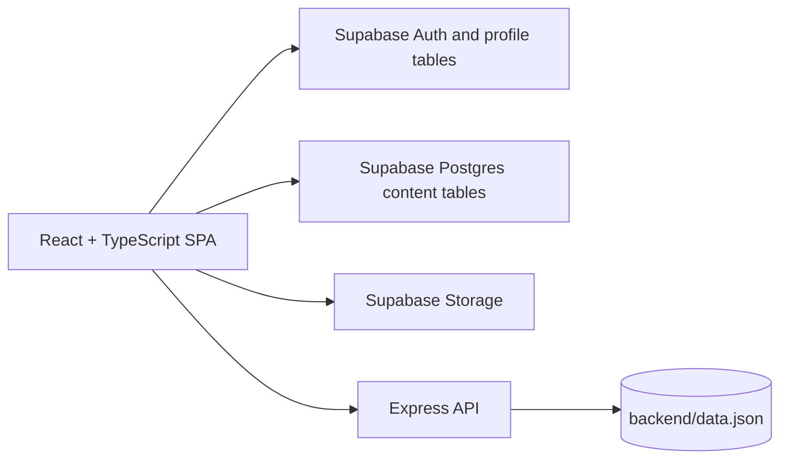

# Campus360

> **One campus. One connected hub.**
>
> Campus360 is a role-based college portal concept for bringing student services,
> campus announcements, events, opportunities, scholarships, and achievements
> together in one responsive web application.


## Contents

- [Why Campus360](#why-campus360)
- [Existing system and current scope](#existing-system-and-current-scope)
- [Features](#features)
- [Technical stack](#technical-stack)
- [How the system is implemented](#how-the-system-is-implemented)
- [Project structure](#project-structure)
- [Run locally](#run-locally)
- [Supabase setup](#supabase-setup)
- [Configuration](#configuration)
- [Routes](#routes)
- [Known limitations and production checklist](#known-limitations-and-production-checklist)
- [Future improvements](#future-improvements)
- [Quality checks](#quality-checks)

## Why Campus360

College information often lives in separate systems: notices are shared in
messages, events are announced by individual departments, opportunities are
circulated manually, and students must search different places for scholarships
and resources. This makes important updates easy to miss and creates repeated
administrative work.

Campus360 brings these workflows into a single portal with separate experiences
for students, super administrators, and club or department heads. Its goal is to
make information easier to publish, discover, and manage.

## Existing system and current scope

Campus360 is an **early-stage application and working prototype**, not yet a
complete production college information system. The codebase contains a React
frontend, a small Express API, Supabase integrations, local demo data, and several
prototype-only screens.

The application currently uses a **hybrid architecture**:

- The frontend connects directly to Supabase for several content workflows.
- The Express API provides legacy login, head-management, event, social-post,
  and opportunity endpoints backed by `backend/data.json`.
- Some frontend screens use seeded data or component state rather than a shared
  persistent database.
- The frontend can be built without cloud credentials, but the current Supabase
  client is initialized at application startup. Configure valid project values
  to run the application.

### Feature implementation status

| Area | Current behavior | Current data source |
|---|---|---|
| Student, super-admin, and head experiences | Role-specific navigation and portal screens | Supabase Auth/profile flows, legacy API, and browser session storage |
| Notices | Student list; admin can publish and delete | Supabase `notices` table when configured; sample list otherwise |
| Events and registrations | Browse and register; admins manage event rosters and event records | Supabase `events` and `event_registrations` when configured; browser/API fallback otherwise |
| Scholarships | Browse, apply, review applications, post scholarship notices, and manage listings | Supabase scholarship and notice tables when configured |
| Achievements | Browse and publish winners; super admin can delete; upload an image to Storage | Supabase `winners` table and `achievement-photos` Storage bucket |
| Head accounts | Super-admin head-account management screens | Supabase `head_credentials` when configured; legacy API or browser fallback in other flows |
| Opportunities | Student-facing cards and admin form are currently prototype-oriented | Student and admin pages include local sample/component state; Express API endpoints also exist |
| Recommendations | Sample opportunity match cards and a scoring explanation | Hard-coded demo data; no live AI model or external AI API is connected |
| Mock tests | Timed, in-browser multiple-choice test examples | Hard-coded questions; results are not saved to a server |
| Documents and bookmarks | Resource and bookmark interface examples | Hard-coded/local component data; not a live document-management service |
| Admin analytics, notifications, settings | Placeholder panels or sample metrics | Demo content; not connected to a reporting or broadcast service |

The “AI recommendations” label describes the intended product direction. The
current recommendation page displays predefined examples and does not call an AI
provider or calculate live recommendations from student records.

## Features

### Student portal

- Student dashboard and profile/settings screens.
- Browse notices, campus events, scholarships, and achievement stories.
- Register for events and view registration-related information.
- Browse opportunity examples and view their details.
- Use a timed sample aptitude/coding test interface.
- Explore sample documents, resources, and bookmarks.
- View example opportunity match scores.

### Super-admin portal

- Admin dashboard and management navigation.
- Create and manage club/department head credentials.
- Publish and delete campus notices.
- Publish events and inspect event registration rosters.
- Create/delete scholarships and review/update application status.
- Publish scholarship announcements.
- Publish achievement records, upload achievement images, and delete records.
- Prototype opportunity-management form and admin placeholder pages.

### Club and department head portal

- Head dashboard and event-management entry points.
- Browse campus events and view student registration lists.
- First-login password-change flow in the legacy head-login experience.

## Technical stack

| Layer | Technology |
|---|---|
| Frontend | React 19, TypeScript, Vite 8 |
| Routing | React Router |
| Styling | Tailwind CSS utilities with project CSS |
| Icons and animation | Lucide React, Framer Motion |
| Cloud data and file storage | Supabase JavaScript client, Supabase Postgres, Supabase Storage |
| API | Node.js, Express 5, TypeScript |
| Legacy API persistence | JSON file at `backend/data.json` |
| Linting | Oxlint |
| Frontend hosting configuration | Vercel SPA rewrite in `frontend/vercel.json` |

There is no paid AI integration in the current implementation. This README update
adds no package dependencies or external service requirements.

## How the system is implemented



### Frontend

`frontend/src/App.tsx` defines the routes. `AuthContext` provides session and user
state, while the sidebar selects navigation based on the current role. Feature
pages call methods from `frontend/src/services/api.ts`. That service contains
Supabase table operations, legacy HTTP requests, and local-storage/sample-data
fallbacks used by some features.

### Backend

`backend/src/index.ts` defines the Express routes. `backend/src/db.ts` loads and
saves legacy data in `backend/data.json`; it does not use PostgreSQL directly.
The backend is useful for existing API workflows, but it is not the only data
path used by the frontend.

### Supabase data model

The SQL scripts define the core entities used by the app:

- `profiles`, `admins`, `heads`, and `head_credentials` — identity/profile and
  head-account records. `heads` and `head_credentials` include overlapping
  legacy/current structures.
- `events` and `event_registrations` — published events and student
  registrations. Deleting an event cascades to its registrations.
- `scholarships` and `scholarship_applications` — scholarship listings and
  applications. Deleting a scholarship cascades to its applications.
- `notices` — campus and scholarship notices.
- `winners` — achievement records, including `image_url`.
- Supabase Storage bucket `achievement-photos` — uploaded achievement images;
  the public URL is stored on the winner record.

### Request and persistence flow

1. A user opens a role-specific route in the React app.
2. The page calls a method from the central API service.
3. If Supabase is configured, supported content methods read/write Supabase.
4. Selected legacy methods call the Express API, which persists to `data.json`.
5. Prototype-only pages may use local state or hard-coded records instead.

The architecture is deliberately documented as it exists today; it should not be
assumed that every page is backed by one database or that every listed feature
has production-grade persistence.

## Project structure

```text
Campus360/
├── README.md
├── backend/
│   ├── data.json
│   ├── schema.sql
│   ├── supabase_login_schema.sql
│   ├── supabase_content_policies.sql
│   └── src/
│       ├── db.ts
│       └── index.ts
└── frontend/
    ├── .env                 # Local Supabase configuration; do not commit
    ├── vercel.json          # SPA route fallback
    └── src/
        ├── components/      # Layout, navigation
        ├── context/         # Authentication/session state
        ├── lib/             # Supabase client
        ├── pages/           # Student, head, and admin screens
        └── services/        # Frontend API and persistence operations
```

## Run locally

Use Node.js 20.19+ or 22.12+ for the Vite version in `frontend/package.json`.

### 1. Configure Supabase

Create `frontend/.env` using the variables in
[Configuration](#configuration). Set up the database using
[Supabase setup](#supabase-setup).

### 2. Start the frontend

```bash
cd frontend
npm install
npm run dev
```

Vite starts the web app and proxies `/api` requests to `http://localhost:5000`
as configured in `frontend/vite.config.ts`.

### 3. Start the legacy API when needed

Open a second terminal:

```bash
cd backend
npm install
npm run dev
```

The API listens on port `5000` by default. Set `PORT` to use a different port.
Start the backend for flows that still use the Express API, such as legacy head
login or API-backed content fallback. Supabase-backed table operations run
directly from the browser.

### Useful frontend commands

```bash
npm run build    # Type-check and create the production bundle
npm run lint     # Run Oxlint
npm run preview  # Preview the production build locally
```

## Supabase setup

1. Create a Supabase project for development or testing.
2. In **Project Settings → API**, copy the project URL and public anon/publishable
   key into `frontend/.env`.
3. In the Supabase SQL Editor, run `backend/supabase_login_schema.sql` to create
   the login-compatible tables and shared content tables.
4. Run `backend/supabase_content_policies.sql` to configure the policies and
   `achievement-photos` Storage bucket required by the current content workflows.
5. Restart Vite after changing `.env`.
6. Test each role and content flow in the application.

`backend/schema.sql` is an earlier/core schema variant. For a fresh installation
using the current login flow, use the login-compatible schema above rather than
blindly applying both schema files. If the project already has tables, inspect
the existing schema and back up important data before applying changes.

### Important Supabase security warning

The current app includes a custom/legacy login flow and performs several data
operations directly from the browser using the public anon key. The supplied
starter policies allow broad anon access so the prototype’s CRUD flows can run;
they are **not authorization controls**. Do not use those policies as a secure
production boundary. Before production:

- Use Supabase Auth for each actor and enforce admin/head/student access with
  restrictive Row Level Security policies.
- Move privileged operations (such as creating accounts or issuing credentials)
  behind a trusted server/Edge Function.
- Never place a Supabase service-role key in frontend environment variables.
- Replace or remove demo accounts and sample credentials inserted by SQL scripts.
- Review data access, backups, retention, and access logging.

## Configuration

Create `frontend/.env`:

```dotenv
VITE_SUPABASE_URL=https://YOUR_PROJECT_ID.supabase.co
VITE_SUPABASE_ANON_KEY=YOUR_PUBLIC_ANON_KEY
```

Only use the public anon/publishable key in the browser. Do not put database
passwords, JWT secrets, or the Supabase service-role key in `frontend/.env`.
Values prefixed with `VITE_` are included in the client bundle.

The backend optionally reads `PORT` from its environment. Its JSON persistence
file is `backend/data.json`.

## Routes

### Public

| Path | Screen |
|---|---|
| `/` | Landing page |
| `/login` | Login and account setup |

### Student portal

| Path | Screen |
|---|---|
| `/dashboard` | Student dashboard |
| `/notices` | Campus notices |
| `/opportunities` | Opportunity browser |
| `/opportunity/:id` | Opportunity details |
| `/events` | Events and drives |
| `/scholarships` | Scholarship portal |
| `/achievements` | Achievement gallery |
| `/mock-tests` | Sample timed tests |
| `/documents` | Sample resources |
| `/ai-recommendations` | Example matching results |
| `/bookmarks` | Sample bookmarks |
| `/profile` | Student profile |
| `/settings` | Account settings |

### Head portal

| Path | Screen |
|---|---|
| `/head/dashboard` | Head dashboard and event management |
| `/head/events` | Head dashboard/event entry point |

### Super-admin portal

| Path | Screen |
|---|---|
| `/admin/dashboard` | Admin dashboard |
| `/admin/generate-heads` | Head credentials |
| `/admin/events` | Event and roster management |
| `/admin/notices` | Notice management |
| `/admin/opportunities` | Opportunity-management prototype |
| `/admin/scholarships` | Scholarship management |
| `/admin/achievements` | Achievement management |
| `/admin/settings` | Placeholder settings panel |
| `/admin/analytics` | Placeholder analytics panel |
| `/admin/notifications` | Placeholder notifications panel |

The routes are defined in `frontend/src/App.tsx`. The current route setup renders
the portal pages but should not be treated as server-enforced access control.

## Known limitations and production checklist

- **Authorization:** Several screens are protected only by frontend navigation or
  session state. A browser-only role check is not a security boundary.
- **Database policies:** Starter RLS policies permit broad access and must be
  replaced with role-aware policies for production.
- **Legacy authentication:** The Express example stores credentials in a local
  JSON data file and issues a simple client token. Do not use this approach for
  production authentication.
- **Split persistence:** Supabase, the Express JSON API, local storage, and
  component-level demo data coexist. Pick a single source of truth per feature
  before scaling.
- **Demo modules:** Recommendations, documents, bookmarks, some opportunity
  cards, and admin metrics include hard-coded or local demo data.
- **API deployment:** The Vercel configuration rewrites browser routes to the
  SPA entry point; it does not deploy the Express server. Deploy the API
  separately and configure an API proxy/base URL before relying on `/api` flows
  in production.
- **Storage:** Achievement uploads require the bucket and Storage policies from
  `backend/supabase_content_policies.sql`.
- **Testing:** The frontend package currently defines build and lint scripts but
  no dedicated test script.
- **Scalability:** `backend/data.json` is suitable only for local/demo
  persistence, not concurrent production workloads.

## Future improvements

1. Consolidate persistence behind Supabase or a versioned server API; remove
   duplicate local-storage and JSON sources for production features.
2. Add secure, role-aware authorization and RLS policies for every table and
   Storage operation.
3. Replace demo login and credential handling with a single supported
   authentication flow, hashed credentials, and secure session management.
4. Connect opportunities to persistent CRUD, student applications, and
   searchable/filterable live listings.
5. Make recommendation scoring data-driven and explainable; only add an AI
   provider if the product requires it and the operating cost is approved.
6. Store documents in managed object storage and make download/bookmark actions
   persistent.
7. Add automated tests for data services, permissions, registration limits,
   deletes/cascades, and image upload behavior.
8. Add pagination, validation, loading/error/empty states, audit logs, and
   administrator activity history.
9. Define a production API deployment and environment strategy, monitoring,
   backups, and database migration workflow.
10. Improve accessibility, mobile usability, and performance through
    interaction testing and route-level code splitting.

## Quality checks

Run these from `frontend/`:

```bash
npm run build
npm run lint
```

The build runs TypeScript project checks before generating the Vite bundle.
Lint findings should be reviewed before release; a successful build alone does
not validate database policies, account permissions, or cloud connectivity.
